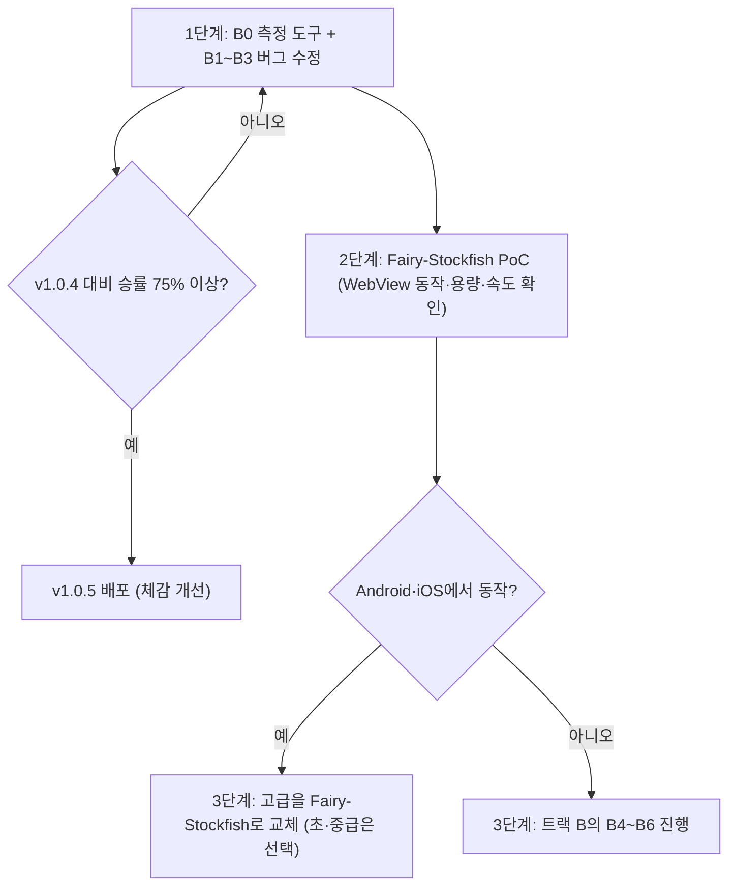

# 고수(고급) 난이도 근본 개선 작업계획서 (실측 기반)

> **실행 명령 프롬프트**  
> 아직도 고수의 난이도가 너무 쉽습니다. 이전과 큰 차이를 느낄 수 없습니다.  
> 확실하게 고수 레벨 난이도를 올리기 위한 작업 계획서를 작성해주세요.

---

## 0. 지난 보고 내용 정정

v1.0.3·v1.0.4 보고서에 적은 **"50배 가속", "최대 10수 수읽기", "아마 3~5단"** 같은 수치는 **실측 없이 쓴 추정치**였습니다. 체감 차이가 없었던 것은 당연한 결과이며, 이번 계획은 **실제 측정 결과**를 근거로 작성했습니다.

---

## 1. 실측 결과 (PC Node.js 환경, `index.html` 엔진 코드를 그대로 추출하여 측정)

| 항목 | 측정값 | 의미 |
|---|---|---|
| 고급 첫 수 계산 | **탐색 노드 0개**, 3ms | 오프닝북이 수읽기 없이 바로 둠 |
| 오프닝북 적용 구간 | 대국 기록 16수 미만 | **AI(초)의 처음 약 8수를 규칙 몇 줄이 대신 둠** |
| 초당 탐색 노드 | 약 11만~14만 (PC) | 모바일 WebView는 보통 3~5배 느림 |
| 3.2초 동안 완주한 깊이 | **5~6 반수(ply)** (PC) | 내 수·상대 수를 합쳐 6번 = **각자 3수 정도** |
| 모바일 예상 깊이 | 3~4 반수 | 각자 2수 정도 |
| 고급 장군 보너스 | **1,500점** (차 1,300점보다 큼) | 장군 한 번을 차 한 대보다 높게 평가 |

> [!NOTE]
> 기존 문서의 "7수"는 반수(ply) 기준이었습니다. 장기에서 흔히 말하는 "몇 수 앞"으로 환산하면 실제로는 3수 정도를 읽고 있었습니다.

---

## 2. 고수가 약한 진짜 원인 (영향이 큰 순서)

### 원인 1. 오프닝북이 초반을 망치고 있음 (가장 큼)
- v1.0.4에서 고급의 오프닝북 구간을 10 → **16수로 늘린 것이 오히려 기력을 떨어뜨렸습니다.**
- 북의 실체는 "조건에 맞는 첫 번째 수"를 고르는 규칙 8줄입니다. 예: "차를 1선이나 4선으로 옮기는 수가 있으면 무조건 둠", "궁을 아래로 내림".
- 안전 검사도 **옮긴 기물 하나가 잡히는지만** 보고, 그 수 때문에 다른 기물이 노출되는지는 보지 않습니다.
- 결과: 사람이 초반에 함정을 파도 AI는 수읽기 없이 정해진 수를 두고, 초반에 이미 불리해집니다.

### 원인 2. 평가함수 왜곡 → "어설픈 수"의 직접 원인
- **장군 상태 보너스 1,500점 > 차 1,300점**: 탐색 끝자락에서 장군을 부를 수 있으면 차를 내주는 수도 좋게 평가합니다. 의미 없는 장군, 기물 헌납이 여기서 나옵니다.
- 상대 궁 근처 차 +120, 적진 침투 +150 등 압박 보너스가 커서 **차가 무모하게 적진에 뛰어들었다가 갇히는** 패턴이 생깁니다.

### 원인 3. 정적 탐색(Quiescence) 결함
- 장군을 받은 상태에서도 "가만히 있기(stand-pat)" 점수를 인정합니다. 실제 장기에서는 장군을 받으면 반드시 피해야 하므로, **외통수 위협을 과소평가**합니다.
- 포획 수만 보고 장군 회피·장군 연속(연장군)은 보지 않아 **외통 수순을 놓칩니다.**

### 원인 4. 탐색 깊이 자체가 얕음
- 현대 엔진의 기본 기법(Null Move 가지치기, 후순위 수 축소 탐색(LMR), History 정렬, 장군 연장, 증분 해시)이 없습니다.
- 메인 UI 스레드에서 돌아가 시간을 더 쓸 수 없습니다.

### 원인 5. 검증 체계 부재 (지난 두 번이 실패한 이유)
- 개선 전후를 비교하는 **자가대국·전술 문제 테스트가 없어서**, 바꾼 것이 실제로 강해졌는지 확인하지 못한 채 배포했습니다.

---

## 3. 해결 방안: 두 가지 트랙

### 트랙 A (권장, 가장 확실): 검증된 오픈소스 엔진 Fairy-Stockfish 탑재

**Fairy-Stockfish**는 체스 최강 엔진 Stockfish를 기반으로 **장기(Janggi)를 공식 지원**하는 오픈소스 엔진입니다. NNUE(신경망 평가)를 쓰면 사람 최상위권을 넘는 기력이며, 장기 사이트(PyChess 등)에서 실제로 쓰이고 있습니다. 브라우저용 WebAssembly 빌드(`fairy-stockfish-nnue.wasm`)가 있습니다.

| 장점 | 내용 |
|---|---|
| 기력 | 일반인은 물론 유단자도 이기기 어려운 수준 보장 |
| 난이도 조절 | 엔진 자체 `Skill Level`·탐색 시간으로 초급/중급/고급을 일관되게 조절 가능 |
| 검증 | 수년간 대국 사이트에서 검증된 규칙 처리·수읽기 |

| 위험 요소 (사전 확인 필요) | 대응 |
|---|---|
| **GPL-3.0 라이선스**: 엔진을 포함해 배포하면 앱 소스도 GPL로 공개해야 함 | 현재 GitHub 저장소가 공개 상태이므로 라이선스 명시로 대응 가능. **사용자 결정 필요** |
| WASM 다중 스레드 빌드는 `SharedArrayBuffer`와 COOP/COEP 헤더가 필요 | Android WebView·iOS WKWebView에서 동작 여부를 **PoC로 먼저 확인**. 안 되면 단일 스레드 빌드 또는 네이티브(Android NDK / iOS) 빌드 후 브릿지 연결 |
| 앱 용량 증가 (엔진 + 장기용 NNUE 파일, 수 MB) | 현재 APK 9.5MB → 약 15~25MB 예상, PoC에서 실측 |
| 앱 규칙과 엔진 규칙 차이 (4종 차림, 한 수 쉬기, 빅장 등) | 보드 → FEN 변환기 작성, 규칙 차이 항목별 대조표 작성 |

### 트랙 B (자체 엔진 개선): 외부 엔진 없이 현재 코드를 고침

순서가 중요합니다. **측정 도구를 먼저 만들고**, 고칠 때마다 승률로 확인합니다.

| 단계 | 작업 | 예상 효과 |
|---|---|---|
| B0 | **측정 도구**: 헤드리스 자가대국(신버전 vs v1.0.4 100판), 전술 문제집(외통·양걸이 30문항), 실기기 깊이 측정 | 개선 여부를 숫자로 확인 |
| B1 | **고급 오프닝북 제거** 또는 2~4수로 축소 (수읽기로 대체) | 초반 실수 제거, 체감 효과 큼 |
| B2 | **평가함수 정상화**: 장군 보너스 1,500 → 30~50점, 압박 보너스 축소, 기물 안전도(공격받는데 보호 없는 기물 감점) 추가 | 의미 없는 장군·기물 헌납 제거 |
| B3 | **Quiescence 수정**: 장군 상태면 모든 회피 수 탐색, 장군 연장(Check Extension) | 외통 수순 발견·방어 |
| B4 | 탐색 기법: Null Move, LMR, History 정렬, Aspiration Window | 같은 시간에 2~3 반수 더 깊이 |
| B5 | 속도: 1차원 배열 보드, make/unmake, 증분 Zobrist 해시 | 속도 2~3배 |
| B6 | **Web Worker 분리**로 고급에 5~8초 사용 + 실기기 측정 | 모바일에서도 PC 수준 깊이 |

> [!WARNING]
> 트랙 B를 끝까지 해도 기대치는 **기원 급수 중상위 수준**입니다. "유단자도 이기기 어려운 수준"은 트랙 B만으로는 보장할 수 없습니다.

---

## 4. 권장 진행 순서

1. **1단계 (즉시 효과)**: 측정 도구 + 오프닝북·평가함수·정적탐색 버그 수정. 자가대국 승률로 효과를 확인한 뒤에만 배포합니다.
2. **2단계 (확실한 기력)**: Fairy-Stockfish를 실제 Android WebView와 iOS WKWebView에서 돌려보는 PoC.
3. **3단계**: PoC 결과에 따라 트랙 A(엔진 교체) 또는 트랙 B 나머지(B4~B6) 진행.

---

## 5. 완료 기준 (이번에는 숫자로 확인)

| 기준 | 목표 |
|---|---|
| 신버전 vs v1.0.4 자가대국 100판 | 신버전 승률 **75% 이상** (트랙 A는 95% 이상) |
| 전술 문제집 30문항 정답률 | 트랙 B **70% 이상** / 트랙 A **90% 이상** |
| 실기기(안드로이드) 고급 1수 사고 시간 | 8초 이내, UI 멈춤 없음 |
| 사용자 실전 테스트 | 사용자·류윤석 님 대국에서 "어설픈 수" 피드백 없음 |

결과 보고서에는 위 측정값을 그대로 기재하고, 측정하지 않은 수치는 적지 않습니다.

---

## 6. 결정이 필요한 사항

1. **트랙 선택**: 트랙 A(Fairy-Stockfish, 확실하지만 GPL·용량 증가) / 트랙 B(자체 개선, 기력 한계 있음) / 권장안(1단계 후 PoC로 판단)
2. **GPL-3.0 라이선스 수용 여부**: 트랙 A를 쓰면 앱 소스를 GPL로 공개해야 합니다.
3. **고급 사고 시간 허용치**: 강해지려면 한 수에 5~8초가 필요합니다. 어르신 사용자에게 괜찮은지 결정이 필요합니다.
